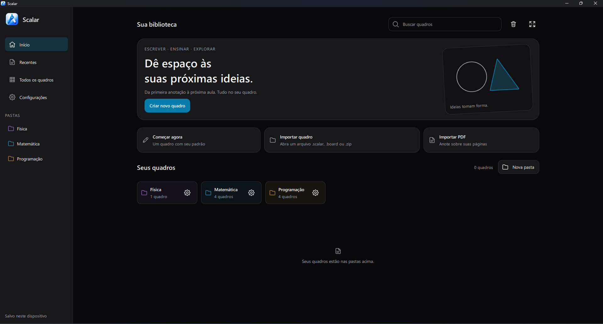
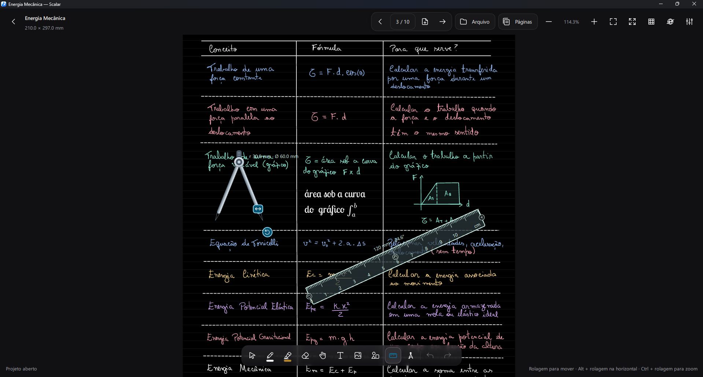

  

<h1 align="center">Scalar</h1>

Um quadro branco para pensar, escrever e explorar ideias.

  
  
  
  

  

<a href="https://github.com/jefersonapps/scalar/releases">Ver todas as versões e downloads</a>

## Um espaço para suas ideias

O Scalar reúne escrita à mão, geometria, texto e documentos em um espaço de trabalho organizado. Seus quadros ficam armazenados no dispositivo e podem ser usados offline.

- **Escreva e desenhe** com caneta sensível à pressão, marcador, borracha e reconhecimento de formas.
- **Explore geometria** com régua, compasso, transferidor, encaixes magnéticos e construções editáveis.
- **Grave construções passo a passo** e reproduza no próprio quadro, com exportação para GIF ou MP4 via FFmpeg.
- **Reúna seus materiais** com imagens, texto, fórmulas LaTeX e PDFs anotáveis.
- **Organize e compartilhe** quadros em pastas, trabalhe com várias páginas e exporte para PDF ou SVG.
- **Pesquise ao lado do quadro** com o navegador lateral no Windows e no Linux e arraste imagens para suas anotações.

## Novidades da versão 1.1.0

Transferidor com desenho guiado, magnetismo para instrumentos, gravação de construções, barra contextual compacta e formatação de texto mais acessível. A versão também melhora o desempenho, a navegação e a estabilidade do desenho. Confira todas as novidades e correções nas [notas da versão 1.1.0](docs/RELEASE_NOTES_1.1.0.md).

## Comece a usar

Baixe a versão para Windows ou Linux na [página de releases](https://github.com/jefersonapps/scalar/releases/latest). Para compilar o aplicativo ou gerar um instalador, consulte o [guia de compilação e instalação](BUILDING.md).

Para conhecer as ferramentas, atalhos e formatos de exportação, acesse o [guia de uso](docs/USAGE.md).

## Documentação

- [Compilação, testes e instaladores](BUILDING.md)
- [Guia de uso](docs/USAGE.md)
- [Navegador lateral](docs/SYSTEM_BROWSER.md)
- [Arquitetura](ARCHITECTURE.md) e [design system](DESIGN_SYSTEM.md)
- [Formato dos arquivos](FILE_FORMAT.md) e [exportação PDF](docs/PDF_EXPORT.md)
